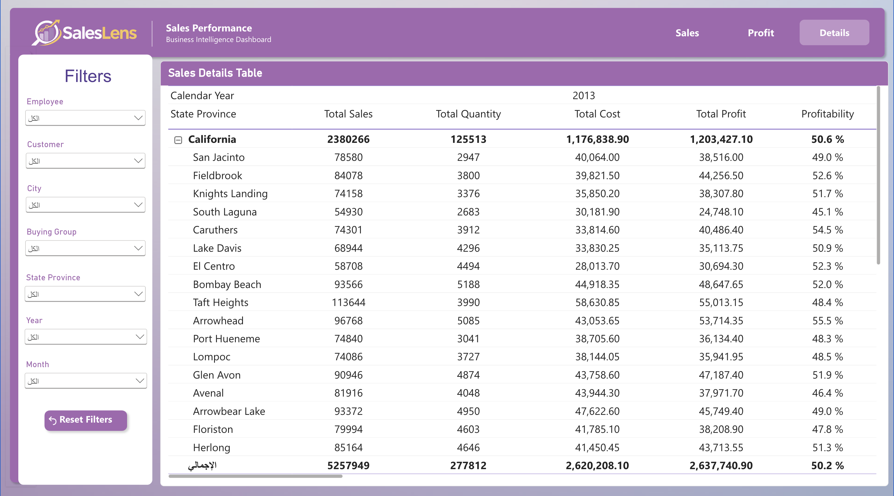

# SalesLens | Sales Performance Analysis

  

## Project Overview

SalesLens is an interactive Business Intelligence project developed using Microsoft Power BI to analyze sales performance, profitability, and product-level data.

The project transforms sales data into meaningful visual insights to support data-driven business decisions.

## Business Objectives

- Monitor overall sales and profitability.
- Analyze sales performance over time.
- Identify high-performing products.
- Explore detailed sales transactions.
- Support business decision-making through interactive dashboards.

## Tools & Technologies

- Microsoft Power BI Service
- Power Query
- DAX (Data Analysis Expressions)
- Data Modeling
- Data Visualization
- Business Intelligence

## Key Performance Indicators (KPIs)

| Metric | Value |
|---|---:|
| Total Sales | 6,347,853 |
| Total Profit | 3,162,081.75 |
| Total Cost | 3,185,771.25 |
| Profit Margin | 49.8% |
| Total Quantity Sold | 314,145 |
| MoM Profit Growth | +2.16% |
## Dashboard Pages

### 1. Sales Dashboard

Provides an overview of sales performance, trends, and key business metrics.

### 2. Profit Dashboard

Focuses on profitability analysis and business performance.

### 3. Details Dashboard

Provides detailed item-level sales analysis with interactive filtering capabilities.

## Dashboard Features

- Interactive slicers and filters
- Dynamic KPI cards
- Cross-filtering between visuals
- Page navigation
- Reset filters functionality
- Consistent visual identity
- Custom SalesLens branding

## Key Insights

- The business generated total sales of 6,347,853 and total profit of 3,162,081.75, achieving an overall profit margin of 49.8%.

- California was the largest contributor to total profit, accounting for approximately 43.7%.

- Nevada achieved the highest profit margin at 50.6%.

- Oregon recorded the lowest profit margin at 49.2%, indicating an opportunity for further investigation.

- The 20 mm Double sided bubble wrap 50m was the most profitable product, generating approximately 210,000 in profit.

- Profitability varied across states, highlighting the importance of regional performance analysis.

## Business Recommendations

- **Regional Strategy:** Maintain strong performance in California, which contributes approximately 43.7% of total profit.

- **Profit Optimization:** Investigate Nevada's pricing and cost structure to identify practices that may improve profitability in other states.

- **Cost Management:** Analyze operating costs, pricing, and product mix in Oregon to identify opportunities for margin improvement.

- **Inventory Planning:** Prioritize inventory availability for high-profit products, particularly the 20 mm Double sided bubble wrap 50m, while considering demand.

- **Risk Management:** Explore opportunities to diversify profit contributions across different states.

- **Performance Monitoring:** Track monthly sales, profit margins, and profit growth to identify emerging trends.

## Skills Demonstrated

- Data Analysis
- Business Intelligence
- DAX Calculations
- KPI Development
- Interactive Dashboard Design
- Data Visualization
- Analytical Thinking
- Data Storytelling

## Project Purpose

This project was developed as part of a Data Analytics portfolio to demonstrate practical Business Intelligence and Power BI skills.
