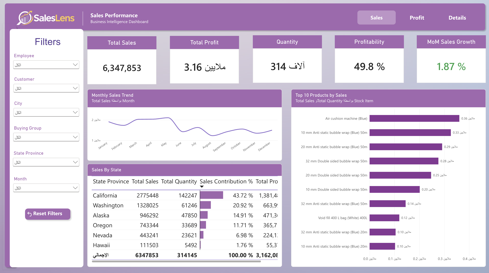
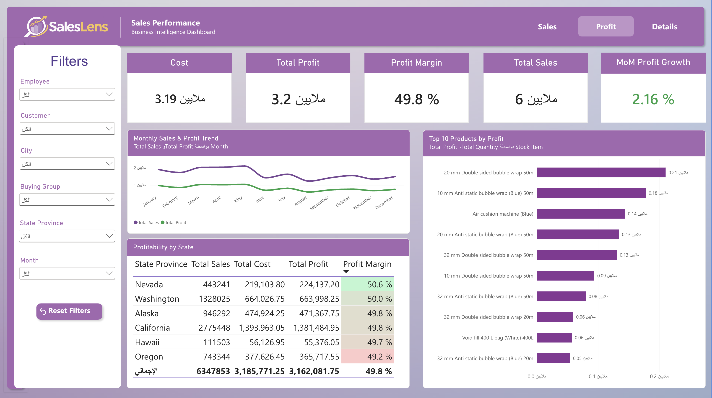

# SalesLens | Sales Performance Analysis

  

## Project Overview

SalesLens is an interactive Business Intelligence project developed using Microsoft Power BI to analyze sales performance, profitability, and product-level data.

The project transforms sales data into meaningful visual insights to support data-driven business decisions.

## Business Objectives

- Monitor overall sales and profitability.
- Analyze sales performance over time.
- Identify high-performing products.
- Explore detailed sales transactions.
- Support business decision-making through interactive dashboards.

## Tools & Technologies

- Microsoft Power BI Service
- Power Query
- DAX (Data Analysis Expressions)
- Data Modeling
- Data Visualization
- Business Intelligence

## Key Performance Indicators (KPIs)

- Total Sales: 6,347,853
- Total Quantity Sold: 314,145
- Total Profit

## Dashboard Pages

### 1. Sales Dashboard

Provides an overview of sales performance, trends, and key business metrics.

### 2. Profit Dashboard

Focuses on profitability analysis and business performance.

### 3. Details Dashboard

Provides detailed item-level sales analysis with interactive filtering capabilities.

## Dashboard Features

- Interactive slicers and filters
- Dynamic KPI cards
- Cross-filtering between visuals
- Page navigation
- Reset filters functionality
- Consistent visual identity
- Custom SalesLens branding

## Business Recommendations

- Monitor sales and profitability trends regularly.
- Identify opportunities to improve product performance.
- Evaluate low-performing products.
- Use sales insights to support inventory and business planning.

## Skills Demonstrated

- Data Analysis
- Business Intelligence
- DAX Calculations
- KPI Development
- Interactive Dashboard Design
- Data Visualization
- Analytical Thinking
- Data Storytelling

## Project Purpose

This project was developed as part of a Data Analytics portfolio to demonstrate practical Business Intelligence and Power BI skills.
