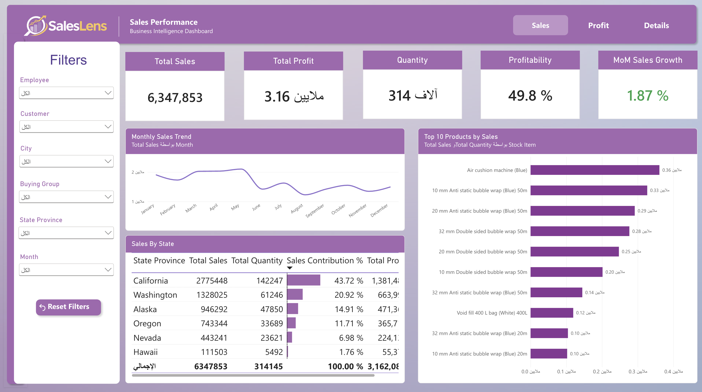

# Hi, I'm Hadeel 

### Data Analytics | Power BI | Data Visualization

Welcome to my Data Analytics Portfolio!

I'm a Computer Science graduate with a background in Cybersecurity and technical training, currently developing my expertise in Data Analytics and Business Intelligence.

I enjoy transforming raw data into meaningful insights through data analysis, visualization, and interactive dashboards.

### Technical Skills
- **Power BI:** Data Visualization, Interactive Dashboards
- **Excel:** Data Analysis and Reporting
- **SQL:** Data Querying
- **Python:** Data Analysis and Programming
- **Data Preparation:** Power Query

### Featured Projects

#### 01 | SalesLens - Sales Performance Analysis

  

An interactive Power BI dashboard designed to analyze sales performance, profitability, regional trends, and product performance using a training dataset.

**Tools:** Power BI | DAX | Data Modeling | Data Visualization

**Project Highlights:**
- Three interactive dashboard pages.
- Dynamic KPIs and advanced filtering.
- Business insights and actionable recommendations.

**[View Full Project](01-PowerBI-Project/README.md)**

---

### Career Objective
Seeking opportunities in Data Analytics and Business Intelligence where I can apply my technical background and analytical skills to support data-driven decision-making.

---

*Thank you for visiting my portfolio!*
